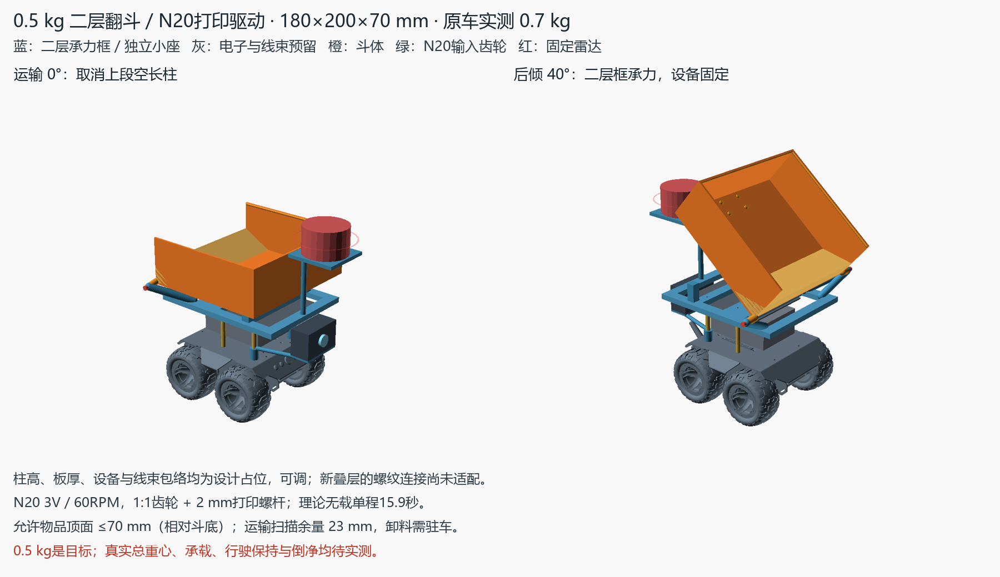
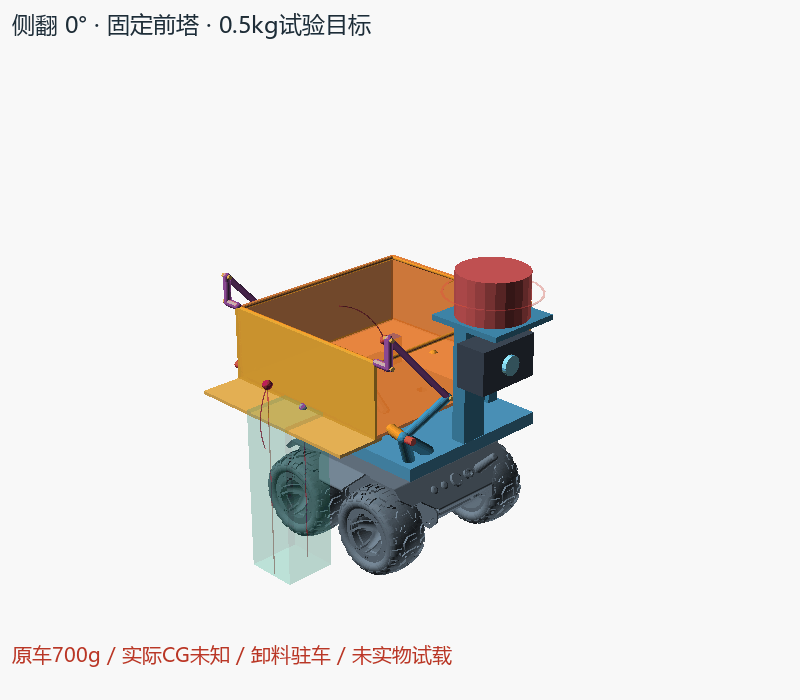

# 二层翻斗，一层相机，二层固定雷达

按用户已同意的布局更新：**取消上段空长柱和第三层大平台，二层连续承力框装翻斗；相机移到一层前端，雷达固定在二层前部独立细支座**。斗与承力框在上一布局基础上再前移5 mm，斗中心从X=-20至-15，外包络180×200×70 mm及0–40°不变；无活动门、一体低斜后壁、后横轴和单丝杆保留，不增加金属加强条。





新增 [N20打印驱动与11类STL](../n20_printed_drive_v0/README.md)：用户确认3V、60RPM，机身/轴来自商家图，工作扭矩仍未知。真实齿轮、螺杆、滑块、独立止推壳和上下M3转接座已替换原圆筒占位。

默认0°不透明完整斗体；剖切、CG和落料框都关闭。黑色中层板仅为轮廓/孔位占位，**没有导入旧200×160×12生产底板，也未把它当成照片中真实中层板**。灰盒为电子及线束预算，未证明照片盘线已能收进去。

## 当前可调设计值

用OpenSCAD打开 [compact_dump.scad](compact_dump.scad)，`dump_angle`控制倾角，`animate=true`配合`$t`播放去回。以下均为设计占位，尺寸尚未实测。

| 项目 | 当前值 |
|---|---|
| 二层叠层 | 下段柱60 mm + 中层板2 mm + 承力框8 mm，框顶Z70 |
| 斗及后轴 | 中心X=-15/Y0，后轴沿Y、X=-105/Z97；斗180×200×70 |
| 固定后坡 | 45 mm行程抬25 mm，内底3 mm；40°时向外下坡10.945° |
| 电子/线束单盒 | 100×72×40 mm，中心X=-20，Z13..53；真实布线待实配 |
| 一层相机 | 中心X100/Z40，64宽×30深×40高；独立架从一层前两孔位分出 |
| 二层雷达 | 中心X115、扫描面Z190，Ø65×40占位；细柱脚X81 |
| N20打印驱动 | 铰距80.025→111.802 mm，行程31.777 mm；上耳下移3 mm，1:1/2 mm导程理论无载15.888秒 |
| 运输物品扫描包络 | 顶面相对斗底≤70 mm，扫描余23 mm；这不代表散料能满装70 mm |

承力框的两侧梁、端梁和中横梁连四孔，后轴座/前承托/丝杆下耳均落在框上，推力不压电子板。原四孔X±29/Y±43继续作为定位依据。旧用户所述柱顶约5 mm露牙属于原堆叠状态，板2+框8的新叠层**不能默认沿用露牙夹紧**；公母牙、板厚、固定座与新螺丝长度待实配。

相机架脚在一层前孔局部定位，套脚夹持与销耳仍为概念接口。上下M3驱动转接座已有试装STL，整车四柱叠层与传感器支架仍是概念接口；真实相机外形/FOV、雷达出光高度、支架固定及转动公差未完成实配，当前模型不能直接作为装车生产件。

## 本轮验证

```powershell
$env:PYTHONPATH='E:/rober/tools/cad-python'
python -B docs/hardware/cad/compact_dump_v2/verify.py
python -B docs/hardware/cad/compact_dump_v2/render.py --openscad E:/rober/tools/openscad/openscad.com
```

[verification.json](exports/verification.json)和 [render_check.json](exports/render_check.json)绑定整车源与打印驱动依赖哈希。默认与有意义变参各82个去回姿态（1°步长）通过；行程、低雷达、无坡程、坡不下行、电子盒撞柱、装载超扫描等6项非法配置拒绝。

电子盒对原柱名义间隙3.5 mm、对板底7 mm；全部固定件最紧为相机套脚保守盒旁0.5 mm，空间较紧，不能替代收线和打印误差复核。移动斗距电子盒最小44 mm；斗对雷达细柱2 mm，主支撑杆1.256 mm，打印驱动1.135 mm（分件外包络）。验证采用保守盒/圆端杆，安装点、柱顶/板/框和托板接触面仅作局部接口豁免，没有整块电子盒碰撞豁免。

运输时扫描平面高于斗和允许物品包络23 mm；8°起整数采样出现遮挡，后倾卸料需驻车，不能依赖受挡扫描导航。本轮未实现控制互锁。低相机按水平视轴、水平70°/竖直50°假设视锥，从镜头点检查前方所有障碍；相机机身与厂家车体保守分离量8.583 mm。最近地面交点距镜头约275.617 mm，约27.6 cm内有近地盲区；真实俯仰/FOV仍待调，未新增俯仰机构。

## 卸料与重心边界

50/70 mm立方块沿实际固定斜壁、按脚印最高支承面保持姿态、完全离口再竖落，各100姿态通过；对原车包络最小9.569 mm。70 mm块只是补充通道测试，斗内净高67 mm，它不符合满装运输的70 mm总高预算。实际垃圾可能转动、提前掉落或被摩擦阻滞，假设路径不保证自行滑出或倒净。

真实出口40°时X=-122.998/Z118.449；直接在出口点竖落的50/70 mm框分别与厂家含轮AABB重叠16.197/26.197 mm，失败保留。斗前移缩小了后方直接落料余量，不能只看重心点前移就忽略此限制。

与上一布局使用相同局部垃圾点假设比较，40°时各点X前移3.830 mm；这仅是同一假设的可比值。原车0.7 kg、目标垃圾0.5 kg为历史用户输入，新加框/楔/执行器/设备重量和真实车CG未知，状态仍为`not_certified`。没有宣称防翻已解决或整车重心已经居中。

低后沿只挡内底以上25 mm散料；行驶保持、液体密封、打印刚度、0.5 kg承载、摩擦与倒净未验证。下一步按实物尺寸收线、确认层高和新叠层紧固，先空斗手动走行程，先手转打印驱动、核对用户电机持续扭矩，再逐级试载。

## 来源与相关图

依据 [VENDOR_INDEX.md](../../../vendor/VENDOR_INDEX.md)、本地WAVE ROVER DXF的58×86 mm四孔轴距及 [孔位记录](../ground_dump_v0/mount_reference.json)。原耳孔Ø2.6，用户使用M2.5。整车直接读取 [厂家STL](../../../vendor/waveshare_wave_rover/WAVE%20ROVER_MODEL_STL.stl)，变换`X=rawY-22.641541,Y=-rawX,Z=rawZ-52.7359`，无缩放。

[实车层级示意](../../dump_as_built_plan.md)已同步批准布局；用户照片未入库。旧生产板、被否决大斗、暂停桶体和历史sprint均未改，无ROS或OKR比例变更。
