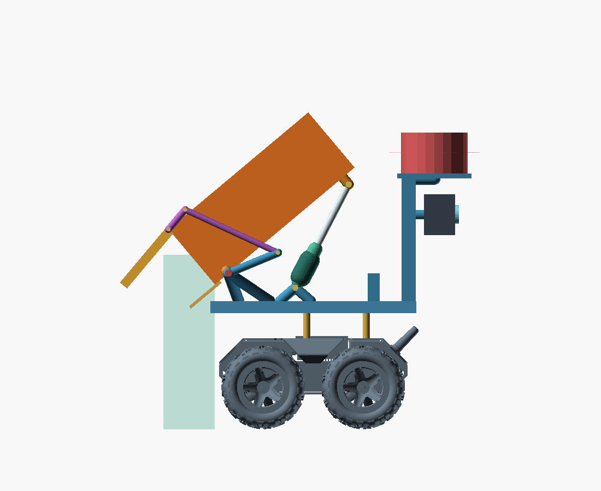

# 0.5 kg小斗后卸：整车运动与布局稿

当前入口已按用户要求改为**后开门、向车尾倾翻**：180×200×70 mm斗（外包络2.52 L）、前固定雷达/相机、原四根M2.5柱。相机朝向为设计车头+X，黄色门在车尾-X。用户实测原车约0.7 kg，垃圾目标0.5 kg；旧侧翻保留在Git历史，400 mm大斗已否决。


**默认0°、不透明完整四周围壁、后门闭合**。本稿是可调运动和空间样机，真实车CG、新附件重量、打印强度及0.5 kg装载均未实测。请勿直接导出整机当生产件。

## 打开和调参数

用OpenSCAD打开 [compact_dump.scad](compact_dump.scad)。`dump_angle`为0–40°；`animate=true`后由`$t`驱动去回。`cutaway`、`show_cg`、`show_drop_envelope`均默认关闭，仅供调试。CG点为假设垃圾局部偏载的姿态轨迹，未模拟袋体运动。

| 项目 | 当前设计值 |
|---|---|
| 斗中心/尺寸 | X=-35/Y0；180×200×70 mm |
| 后横轴 | 沿Y，X=-105；Z=63 mm |
| 原柱高 | 24 mm占位，外露约5 mm螺杆与柱高不同 |
| 后导料唇 | 外伸30 mm、底板下内搭6 mm；斗含唇长210 mm |
| 横向机构包络 | 主销长16 mm、轴端Y±114，销杆总宽244 mm；斗本体200 mm |
| 后门 | 两侧四杆闭环；0°闭合、40°倾斗时门绝对角-40°，相对斗开80° |
| 门搭边/止挡 | 两侧向前套6 mm，名义侧隙0.3 mm；两块内侧关闭止挡 |
| 丝杆占位 | 铰距80.156→112.923 mm，所需几何行程32.767 mm，型号未选 |
| 前设备 | 塔脚X70；雷达中心X95/扫描面Z180；相机X100/Z120，朝+X |
| 设备外形 | 雷达Ø65×40、相机64宽×30深×40高，均为可调占位 |

0°后门内面X=-122与底板接触600 mm²、与两侧壁各201 mm²，固定壁与底板相接。外套边绕过侧壁、内部止挡限制闭合位置，名义模型四周无直接通缝；顶部敞口。**实际打印间隙、压紧、密封条、细碎垃圾和液体防漏尚未验证。** 四杆/执行器保持机构需要制动或经验证的自锁，未知丝杆不会自动获得此能力。

## 几何验证

```powershell
$env:PYTHONPATH='E:/rober/tools/cad-python'
python -B docs/hardware/cad/compact_dump_v2/verify.py
python -B docs/hardware/cad/compact_dump_v2/render.py --openscad E:/rober/tools/openscad/openscad.com
```

[verification.json](exports/verification.json)与 [render_check.json](exports/render_check.json)绑定当前源哈希。默认和变参各82个去回姿态（每1°）通过；四杆杆长闭合、分支连续、最小传动sin约0.656，丝杆最小力臂18.027 mm。完整斗、门板/套边、关闭止挡、后唇对厂家含轮AABB、固定架和前设备检查；最近设备分离8 mm、执行器最小间隙2.129 mm。底板分离6.343 mm，支撑杆对运动件最小仅1.256 mm（0°），两项独立报告；后者是名义空间，需按打印误差和变形复核。门套边对斗壁保留0.3 mm名义间隙。所有铰接销耳仅表达共轴连接，轴承、公差和紧固件仍未设计。

独立只读复核用0.25°采样：门套边对斗/止挡最小0.3 mm，门对导唇仅0°接触，门对固定杆胶囊最小8.004 mm，无采样穿透。当前验证采用保守盒与圆端杆，并非精确网格连续碰撞或结构分析。

运输扫描平面高于斗与门杆18.5 mm；**19°起整数采样出现斗遮挡，后卸需驻车并停止依赖受挡扫描导航**。该互锁尚未写入ROS。相机按70°水平/50°竖直假设视锥检查，最近平台竖向余量约29.4 mm；真实FOV和出光位置待测。

## 落料尺寸限制



辅助图绿色框仅表示后唇端附近、包含50 mm高度的竖落通道。50 mm宽通道对原车含轮外包络余4.107 mm；70 mm宽通道重叠5.893 mm。该图不代表任意垃圾袋能通过。

另外分别采样50/70 mm立方块各100个假设姿态：沿倾斜斗底滑出，完全离开导唇才竖落。50 mm块路径通过、距原车包络最小29.873 mm；**70 mm块会碰打开的后门，路径未通过**。真实袋体柔性、摩擦、夹袋和脱离姿态均未模拟。后唇保持30 mm，继续加长会加重后部偏载。

## 载荷结论仍为条件分析

以厂家最低顶点推得的候选后接地区X=-75 mm作筛查边，实车接地范围尚未测量。恢复矩为`0.7×(车CG_X+75)+0.5×(垃圾CG_X+75)+新增附件矩`，单位kg·mm。

- 均匀垃圾到40°时CG_X=-73.874 mm，接近候选后支撑边。
- 口部高35 mm偏载到40°为-142.818 mm；忽略新增附件，要求车CG_X>-26.558 mm。
- 30 mm唇端高35 mm偏载的全角最坏CG_X=-166.033 mm，要求车CG_X>-9.977 mm。
- 唇端高70 mm情景要求车CG_X>5.927 mm。高度沿倾斜斗底法向定义，不能与竖直通道高度混用。

实际车CG和新附件质量/CG均未知，因此报告保持`not_certified`。均匀负载在0–40°内重力矩未变号，物料移到后口可改变力矩方向，执行器仍需双向保持。下一步量真实柱高、车CG及新增附件重量，完善销耳/制动/限位后，从空载和小载荷逐级试验。

## 来源与边界

依据 [VENDOR_INDEX.md](../../../vendor/VENDOR_INDEX.md)、本地WAVE ROVER两张DXF及 [孔位记录](../ground_dump_v0/mount_reference.json)：四孔轴距58×86 mm，原耳孔Ø2.6，用户连接件M2.5。整车来自 [厂家STL](../../../vendor/waveshare_wave_rover/WAVE%20ROVER_MODEL_STL.stl)，变换`X=rawY-22.641541,Y=-rawX,Z=rawZ-52.7359`，未缩放。

原一体底板生产源/STL未改；被否决大斗仅只读复用距离函数，暂停桶体制造未恢复。无ROS、硬件控制或OKR比例变更。
