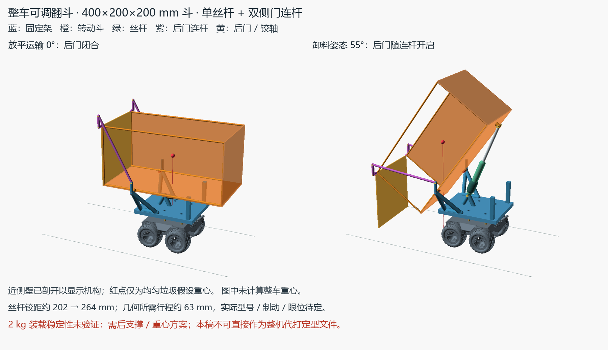
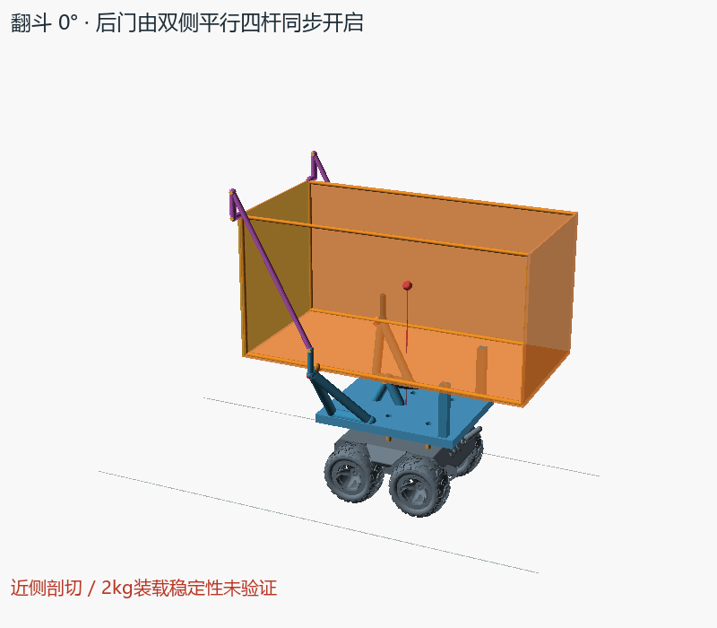

# 整车可调翻斗运动模型

**本方案已被用户否决：400mm大斗的后翻风险与传感器占位不符合需求，禁止作为制造方案。保留文件仅供研究追溯，后续方案见 [小侧斗与固定传感器](../compact_dump_v2/README.md)。**

蓝色底架固定，橙色斗绕主轴转动，绿色丝杆推动斗底，紫色双侧连杆让黄色后门同步开启。可以查看放平、55°卸料和回程。

**当前交付为运动概念稿。2 kg垃圾的装载稳定性未验证，需要后支撑或重心方案；不能直接当作完整翻斗底座或斗体的代打定型文件。** 斗体分块制造仍暂停，原一体底座打印源和STL保持不变。





## 打开与调整

用OpenSCAD打开 [dump_kinematics.scad](dump_kinematics.scad)，可旋转查看、修改参数后预览。`dump_angle`控制姿态，默认35°，允许0–55°；`cutaway=true`剖去近侧壁以看清机构，改为`false`看完整三壁斗；`show_cg`开关红色垃圾重心参考点。`animate=true`使用OpenSCAD的`$t`从放平翻起再回零，也可直接看上面的GIF。

| 参数 | 默认值 | 含义 |
|---|---:|---|
| bucket_length / width / height | 400 / 200 / 200 mm | 斗体外尺寸，销轴、门臂和连杆另占空间 |
| pillar_height | 24 mm | 未实测柱体高度；外露螺杆约5 mm另计 |
| pivot_x | -110 mm | 主轴位置；设计卸料侧为-X，实际车头方向待定 |
| pivot_above_deck | 74 mm | 主轴高出板面；默认主轴Z=110 mm |
| gate_arm | 35 mm | 固定上短臂与门上短臂的共同长度 |
| side_support_offset | 12 mm | 主轴侧座相对斗侧面的外移量 |
| fixed_pin_dx / above_deck | 60 / 35 mm | 丝杆下铰相对主轴X、相对底板Z |
| moving_pin_dx / dz | 260 / -12 mm | 丝杆上铰在斗坐标中的位置 |
| actuator_closed / stroke | 195 / 100 mm | 假设铰距窗口195–295 mm，尚未对应产品型号 |

改参数后运行下述验证命令。SCAD同时限制倾角、行程、门底净空及支座脚落点；全部尺寸组合没有被穷举验证。斗体宽200 mm，外侧销轴总宽约242 mm，运输及翻起空间还需实车留量。导出程序从当前参数生成尺寸、角度及行程图注，要求先更新当前源哈希对应的验证报告。

## 后门如何一起开

主轴为P，门顶铰为H。固定上短臂P→G0与门上短臂H→G1都竖直、等长35 mm；G0→G1长杆与P→H等长，构成双侧平行四边形。门保持世界坐标竖直，斗抬起时门相对斗张开，放平时门重新贴合后口。门姿态来自刚性几何约束，没有另设手动开门动画。

运输约束依靠闭合四杆、放平硬止挡及执行器保持。丝杆需要经确认的双向承载、断电保持或制动能力，不能默认未知丝杆天然自锁。约41.14°后均匀垃圾假设下的重力矩变向，执行器还需承担牵引方向载荷。紫杆按打印连杆概念表达，最终截面与连接待制造设计；本稿没有加入金属加强条。

默认55°时，门面与斗后缘的水平间距约163.83 mm，方向为竖直门面的法向。这一几何间距不等于袋体可通过的真实通径。400×200×200 mm装满软袋能否通过、是否夹袋、摩擦与倒净程度需实际试验。后门打开不能直接证明所有垃圾均能落下。

## 已运行的验证

```powershell
$env:PYTHONPATH='E:/rober/tools/cad-python'
python -B docs/hardware/cad/dump_kinematics_v1/verify.py
python -B docs/hardware/cad/dump_kinematics_v1/render.py --openscad E:/rober/tools/openscad/openscad.com
```

结果见 [verification.json](exports/verification.json) 和 [render_check.json](exports/render_check.json)：

- 默认0–55°每1°去回共112姿态；柱高30、斗高220、轴高出板85 mm的变参另112姿态通过。
- 四杆闭环、门放平贴合、回程重合；最小四杆锐角28.73°，采样内无共线死点。
- 丝杆铰距201.814→264.321 mm，所需行程62.506 mm，最小力臂46.677 mm。这些数值供后续选型匹配，未给出电机推力合格结论。
- 保守包络下斗与固定侧座最小间隙2.736 mm，执行器与斗底最小7.5 mm，后门距厂家最低平面最小23.424 mm。
- 采用包含完整斗壁和圆端边梁的实体外包络、厂家全部STL顶点AABB、实际杆半径胶囊与固定止挡盒。属于离散姿态的保守几何检查，未证明连续运动、弹性变形或紧固件实体间隙。
- OpenSCAD渲染0/27.5/55°及7个动画关键帧通过；倾角超限、行程不足、底脚越界明确拒绝。
- 独立复核另以0.25°检查门杆，完整斗体/后门与杆的最小间隙11.5 mm，长杆与非铰接三角座至少25 mm的Z向分离。

## 实物前仍需处理

1. **后翻稳定性**：红点仅代表均匀2 kg垃圾假设重心，X从-22.64移至55°的-141.81 mm。厂家最低顶点后轮候选接地区约X=-75 mm，尚非实测接触多边形。缺少底盘、斗和执行器质量/重心，当前不作整车稳定通过判断；需确定后支撑、配重或重心布置。
2. **所有铰接接口**：主铰、后门铰、四杆销耳、丝杆上下铰均只表达连接关系，连接处存在有意共轴重合；轴承孔、销轴装拆、公差、螺栓和实体转动间隙尚未完成。禁止将整车模型直接导出作为生产打印件。
3. **原四柱与承载**：真实柱高、M2.5外牙约5 mm有效啮合、底板局部加强、PLA蠕变、斗/机构自重和2 kg垃圾合计载荷均未验证。
4. **执行器与控制**：真实电机包络、闭长、行程、导程、双向推拉力、制动、限位、断电保持需选型回填。深绿色电机段为直径27 mm包络占位。

## 厂家来源

入口为 [VENDOR_INDEX.md](../../../vendor/VENDOR_INDEX.md)。直接读取本地 [WAVE ROVER-EP DXF.dxf](../../../vendor/waveshare_wave_rover/WAVE%20ROVER-EP%20DXF.dxf) 的302/303/311/32E四耳孔，OCS转WCS后58×86 mm、孔径2.6 mm。用户连接件为M2.5。

整车参考 [WAVE ROVER_MODEL_STL.stl](../../../vendor/waveshare_wave_rover/WAVE%20ROVER_MODEL_STL.stl)，经四孔匹配采用 `X=rawY-22.641541, Y=-rawX, Z=rawZ-52.7359` 刚体变换，未缩放。四柱来源还见 [一体底座说明](../main_deck_onepiece_v0/README.md) 及 [四孔核对记录](../ground_dump_v0/mount_reference.json)。新机构截面和支点均为可调整设计值。
