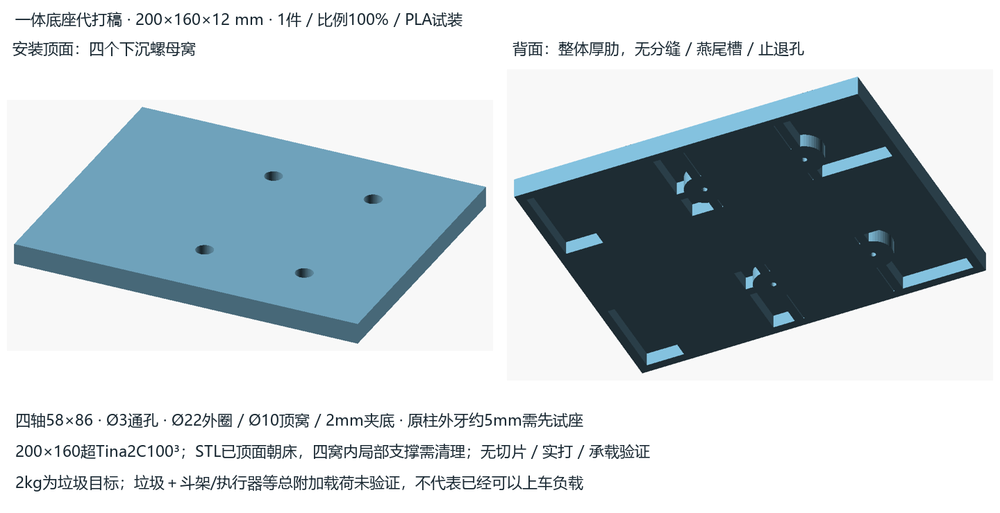

# 200×160 一体底座：代打询价 / 四柱试装稿

一整件200×160×12 mm厚肋底座，替换旧上层板、保留原四柱。原 [Tina2C榫卯分块版](../main_deck_v0/README.md)继续保留；本件去掉所有板缝、七燕尾槽和五个M3止退孔，没有桥键或金属条。背面的肋间凹区保留原轮廓。



## 给代打商直接发

> 文件：[main_deck_onepiece.stl](exports/main_deck_onepiece.stl)，数量1件，单位mm，100%原尺寸，**禁止缩放**。外包络200×160×12 mm，PLA试装稿；整体超出Tina2C的100×100×100 mm范围，需要更大有效成型区，并为裙边/边缘留余量。STL已将安装顶面朝床，背肋向上。四个Ø10安装窝底有环形桥接，请切片检查窝内局部可拆支撑，清干净支撑、疏通Ø3通孔；不要封孔/改孔距。请报价注明材料、支撑/清理方式及预计完成时间。本稿未完成承载验证。

图按安装姿态显示，STL按打印姿态摆放；二者绕X相差180°，几何相同。代打商若调整打印方向，需重新核查皮层/肋和窝底的支撑。

## 原四柱接口与先试座

| 项目 | 本稿值 / 证据 |
|---|---|
| 四轴 | X±29、Y±43，即58×86 mm；本地WAVE ROVER/EP DXF |
| 外形中心 | X=-22.641541，四孔中心O=(0,0)；不得重新居中孔阵 |
| 四安装座 | Ø22全高外圈、Ø10顶部螺母/工具窝、Ø3通孔、2mm夹底，均为设计值 |
| 原柱顶 | 用户确认M2.5外露螺杆约5mm；柱高/原螺母及工具尺寸仍待实配 |

先用已交付的 [单安装座试片](../main_deck_v0/exports/coupons/mount_seat_first.stl)试一根柱：清支撑后让原外牙穿过薄底，用原垫片/螺母旋紧，确认能夹紧、不顶死、不压裂、工具可进入；四柱牙长分别核对。默认2mm夹底＋0.5mm垫＋2mm母（后两项为设计包络）只余约0.5mm外露牙，不能据此承诺有效啮合。

整体件试装时移除旧上层板，四孔落在原柱肩面，螺母/垫片落在顶窝底；不新增长M2.5螺栓，也不使用原分块版M3止退件。支撑柱高度没有实测，本图不画假定柱长。后续斗、架、丝杆/执行器与此板的安装尚未集成；**2kg是垃圾目标，垃圾＋斗架/执行器等总附加载荷未验证**。PLA层间、蠕变、冲击、刚度和柱座受压须另做试装/逐级加载。

## 修改与重导

用 `E:\rober\tools\openscad\openscad.exe` 打开 `main_deck_onepiece.scad`。Customizer可调长宽/总厚/顶皮/肋、夹底/工具窝；四孔事实值请按实测再改。F5预览，F6实体渲染；`print_pose=true` 为顶面朝床。完整一键导出：

```powershell
powershell -NoProfile -ExecutionPolicy Bypass -File E:\rober\docs\hardware\cad\main_deck_onepiece_v0\export.ps1
```

可从任意cwd执行；工具沿用项目内OpenSCAD和Python依赖，支持 `-OpenScad` / `OPENSCAD_EXE`、`-PythonExe`、`-OutputDirectory`。目录仅一件生产STL、顶/底图与[尺寸验证JSON](exports/dimensions.json)，不装软件、不生成G-code、不启动打印。

已读 [vendor索引](../../../vendor/VENDOR_INDEX.md)、两份本地WAVE ROVER DXF及[原始坐标证据](../ground_dump_v0/mount_reference.json)。DXF单位mm，原图上孔2.6/下层圆2.05分别保留，用户M2.5外牙信息独立；新孔3.0及座尺寸为设计间隙。真实网格检查覆盖尺寸、单体封闭、四孔/台阶、原槽/止退孔填回和无分缝；未切片、实打、上车或承载验收。
