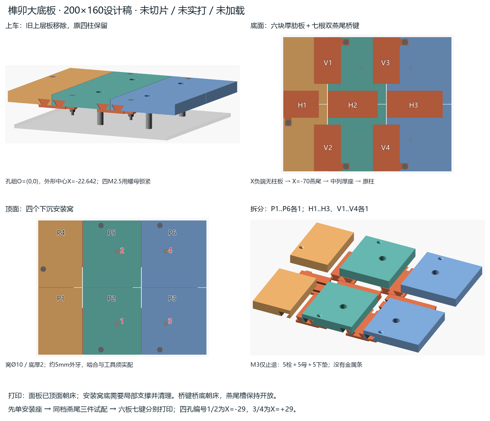
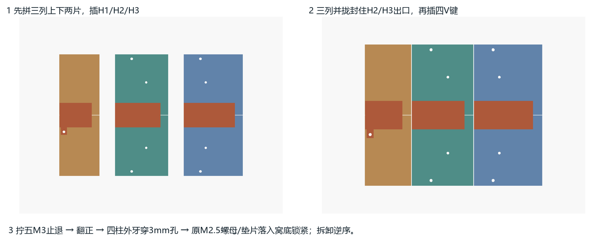

# 榫卯主底板 v0：先试配，再印全板

此稿只做替换旧上层板的大底板，沿用现有四根支撑柱。六块 PLA 厚肋面板由七根双燕尾桥键连接，五枚 M3 小螺丝只防止桥键退出，没有金属条。尚未与旧翻斗/传感器整机草稿集成，也未切片、实打或验证承载。



## 先打印哪件

1. WiiBuilder 选择 Tina2C / PLA，导入 `exports/coupons/mount_seat_first.stl`，单位 mm、100%，先只打这一件。此 24×24×12 座试片已按顶面朝床摆放；在 **Ø10 安装窝内部**设置可从床面生成、可从开放窝取出的局部支撑，切片逐层查看窝底。清除支撑、疏通 Ø3 孔后，再放到一根原柱上，用原垫片/螺母试拧。确认能夹紧、不顶死、不压裂；四柱外露牙分别实测。若不合适，先改 `clamp_thickness` / `nut_well_diameter`，不要硬压全板。
2. 打 `fit_0.3_left.stl`、`fit_0.3_right.stl`、`fit_0.3_bridge.stl`，各一件、分别摆盘。两试片顶面朝床、键桥底朝床，STL 已摆正；燕尾开放斜面约33.7°偏离竖直，通常可免支撑，仍需逐层看切片。若插不进/明显松动，改试同一档 0.2 或 0.4 三件，勿混档、勿整体缩放。随包生产件默认 `fit_clearance=0.3`；若别档试片更合适，必须先改源文件该参数并重新运行 `export.ps1`，再打印新生成的整套生产件。
3. 确认座与接头后，按 [打印清单](exports/PRINT_LIST.md)逐个导入 `exports/print/` 十三个 STL，**分别打印、每件1个**。每片≤79.7 mm，留足 Tina2C 100 mm 平台余量。六面板已顶面朝床，四个安装窝仍需上述局部支撑；桥键桥底朝床。不要把整板示意或多件一起塞进一盘。

0.4 mm 喷嘴建议起点：0.2 mm 层高、4道壁、5层顶底、30%网格/陀螺填充；温度/风扇/速度沿用准确 Tina2C PLA 预设。它们是首次试配建议，不构成承重参数；切片后的有效区/裙边仍须检查。本稿不生成 G-code、不启动打印。

## 看懂安装关系

四孔组中心为 O=(0,0)，轴 X=±29 / Y=±43，孔距58×86。大板设计200×160，中心X=-22.641541；外廓X[-122.641541,77.358459]、Y[-80,80]。X正负为本稿装配坐标，行驶前后尚未由用户确认，不能据图认定车头。

从顶面看：Y<0一排由X小到大为P1/P2/P3，Y>0一排为P4/P5/P6；X列界-70/0，Y行界0，缝0.6 mm。X负端列P1/P4没有柱，载荷须经X=-70双燕尾传到中列P2/P5、再到X=-29两个孔座；中列/X正端列各有两柱。这个实体路径已检查，PLA层间、蠕变、冲击和榫唇强度仍需实测。



1. 顶面向下放。P1+P4、P2+P5、P3+P6分别成三列，上下两片靠0.6 mm缝对齐。各列从X负端插入H1/H2/H3，直到端墙；H1装止退螺丝。
2. 三列并拢。此时相邻列10 mm实体端墙挡住H2/H3出口；再从Y两外边分别插入V1..V4。四根竖键的耳孔对齐后装四枚M3。面板/键耳之间不可夹支撑残料。
3. 五个止退处均从顶面穿M3沉头螺栓，下方装一垫片、一螺母，轻拧至贴合，不能用力压瘪PLA。背面螺母外露；板底到车顶需至少12 mm维护净空（设计准入，实际柱长未知）。拆卸严格逆序；不能在三列锁定时硬拔H2/H3。
4. 移除旧上层板，把新板四孔落到原柱顶肩面。四根**外露M2.5螺杆**穿过薄底，原垫片和螺母在顶窝底锁紧。用户近似实测外牙5 mm；默认2 mm底＋0.5 mm垫＋2 mm螺母（后两项为设计包络）仅余约0.5 mm，不能据此认定啮合合格。窝内工具实际能否进入、螺母是否顶死、四角是否压裂均须先试座再试板。

四个窝使顶面有局部凹口。后续斗/架/执行器需按新底板和凹窝重新布置，不能把整张顶面当无孔连续压载面；本轮不做这些上部机构。**2 kg 是垃圾目标，总附加载荷还含斗、架、执行器等；本稿未验证该载荷。**

## 打印与紧固 BOM

| 物品 | 数量 | 边界 |
|---|---:|---|
| P1..P6 面板 | 各1 | 52.342 / 69.4 / 77.058 ×79.7×12，顶面已朝床 |
| H1/H2/H3 桥键 | 各1 | 42×42.042×9、32×59.4×9、32×66.758×9 |
| V1..V4 桥键 | 各1 | 42×55.4×9，带止退耳 |
| 原四柱 / M2.5螺母和垫片 | 各4 | 柱顶外牙约5 mm；实物规格/啮合待核 |
| M3沉头螺栓、螺母、下垫片 | 各5 | 建议M3×22、头Ø6.5/45°、母AF5.5×2.4、垫Ø7×0.8均为设计包络，采购/长度待核 |
| 单安装座试片 | 1 | 先试外牙与原螺母，再印全板 |
| 同档燕尾left/right/bridge试片 | 各1 | 先0.3，必要时改0.2/0.4；试片不装车 |

## 修改和重新导出

双击 `E:\rober\tools\openscad\openscad.exe`，打开 `main_deck.scad`。右侧 Customizer 可改板长宽/厚度/皮层、单边配合间隙、孔座夹厚/窝径、示意柱高；`part_id` 0为装配，1..6面板，11..17桥键，21..23接头试片，24单座。F5预览，F6实体渲染；单件用File→Export→STL。导出脚本会检查参数可行性和实际网格，不可行组合明确拒绝。

```powershell
powershell -NoProfile -ExecutionPolicy Bypass -File E:\rober\docs\hardware\cad\main_deck_v0\export.ps1
```

脚本从任意cwd定位项目OpenSCAD与 `tools/cad-python`；允许 `-OpenScad`、`OPENSCAD_EXE`、`-PythonExe`、`-DependencyPath`、`-OutputDirectory` 覆盖。真实打印件只在 `exports/print/`，试片只在 `exports/coupons/`；PNG/JSON为参考。检查记录见 `exports/validation.json`，其中包含源SHA256；不会安装软件或启动打印。

## 资料与验证边界

已读 [vendor索引](../../../vendor/VENDOR_INDEX.md)、`WAVE ROVER-EP DXF.dxf` 与 `WAVE ROVER DXF.dxf`，单位 $INSUNITS=4（mm），块比例1。原孔2.6 / 下层图示圆2.05均保留来源事实；下层无攻牙说明。共同四轴来自上层handles302/303/311/32E、下层2DFB/2DFC/2DFD/2E2F；原始坐标和90°映射详见 [既有坐标证据](../ground_dump_v0/mount_reference.json)。外形偏置取下层顶板边界中心与孔组中心差，不从截图估毫米。200×160、厚肋/桥键/新孔/紧固包络均是本稿设计值。

[Tina2C官方核实](../../../vendor/entina_tina2c/PRINT_REFERENCE.md)提供100³/0.4喷嘴/PLA边界；[Prusa打印建模原则](https://help.prusa3d.com/article/modeling-with-3d-printing-in-mind_164135)与[连接切分说明](https://help.prusa3d.com/article/cut-tool_1779?product=cw1)仅用于方向/配合原则，不能证明承重。几何验证包含单体封闭/实际截面、轴线/间隙、插入路径、锁定干涉与工具空间；没有真实切片、试配、逐级加载、HIL或强度证明。发现松脱、裂纹、蠕变或柱牙不足应停止上车试载并改设计。

一体代打试装版见 [main_deck_onepiece_v0](../main_deck_onepiece_v0/README.md)：200×160×12整件保留四柱座，移除拼缝/燕尾槽/止退孔；本目录分块件适配Tina2C，一体版需更大设备，均未验证承载。
