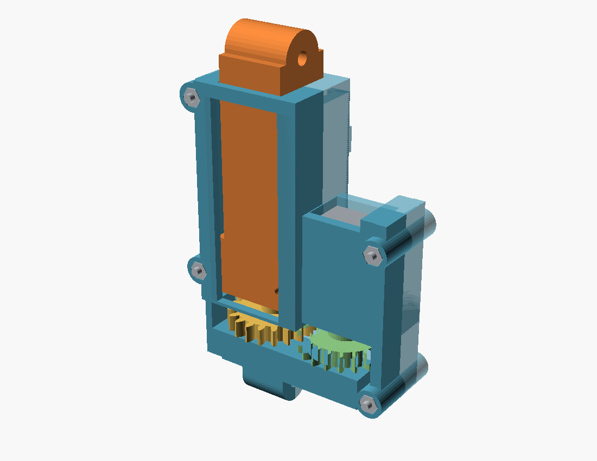
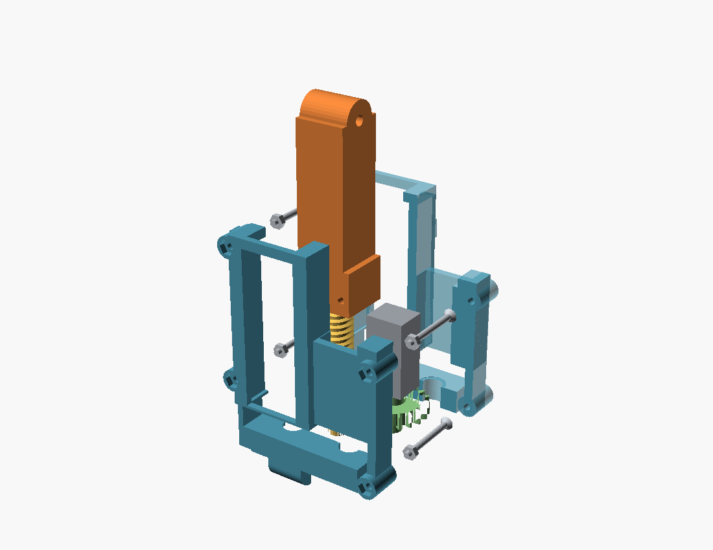

# N20 打印螺杆推举机构：拟合试装版

已按用户确认的 **JGA12-N20、3V、60RPM** 建接口。电机外形取用户提供的商家工程图：12×10×24.1 mm机身、φ3 D轴、外露10 mm、D段9 mm、平面距轴心1.00 mm；实际公差仍需卡尺和试片确认。来源和产品截图见 [本地资料](../../../vendor/n20_reference/REFERENCE.md)。持续工作扭矩未知。

并排电机通过1:1、模数1/20齿打印渐开线齿轮驱动Ø10、单线导程2 mm的打印螺杆。螺杆齿轮与螺杆一体；输入齿轮独立轴颈由壳承托，D孔和径向M2紧定螺钉传扭。丝杆轴肩被两片独立止推垫圈及上下半壳夹持，轴向力沿壳和下转接座回到承力框，电机轴不承担主推举止推力。防转靠双侧C形轨道。

本包是**可打印拟合件**。网格与空间验证不等于PLA强度、电机带载能力、断电自锁或整车稳定通过；当前0.5 kg仍是试验目标。





[下载11类STL压缩包](exports/n20-print-fit-parts.zip) · [可编辑OpenSCAD](drive.scad) · [整车模型](../compact_dump_v2/compact_dump.scad)

## 打印件与朝向

| STL | 数量 | 作用 / 已设定朝向 |
|---|---:|---|
| lower_shell / upper_shell | 各1 | 分体止推壳、导轨和电机夹持；分型面贴床 |
| screw | 1 | 螺杆及螺杆齿轮一体；轴向竖直，底部加裙边，齿轮/轴肩下方需要支撑 |
| slider | 1 | 14 mm母牙、防转块、中空推杆和上铰耳；螺母端朝床 |
| input_gear | 1 | 输入齿轮、独立轴颈、D孔夹紧；轴颈端朝床，齿轮悬挑下方加局部支撑 |
| washer | 2 | 6.4内孔/12外径/0.5厚止推试配片；平放，可按磨损换独立耐磨片 |
| lower_mount / upper_mount | 各1 | 固定框/斗底M3双耳转接座；底面贴床 |
| thread_coupon / male_coupon / shaft_coupon | 各1 | 先验证母牙、外牙与电机D孔；无需先打印整套 |

共11类文件、12个打印件（含3个试片）。所有STL按毫米，默认单件包络小于95 mm；不导出整车生产STL或G-code。外螺纹和母牙根部有明确间隙，不能整体缩放STL来配牙。PLA先用低层高试打短牙，修整接缝后手转全程；参数 `thread_clearance`、`axial_clearance` 和 `fit` 可调，改动后重导全部件。0.5 mm止推片可按0.1 mm层高或实测薄垫替换，重新检查轴向游隙；滑块横销孔、半壳水平孔需查看切片桥接。支撑不得进入D孔和螺纹配合面。初次装配只做空载拟合。

## 标准件与装配

- 用户电机1台；规格匹配仍以实物为准，尾部电极额外留5 mm预算。
- 合壳M2×22沉头螺钉4颗、M2螺母4颗；夹厚20.6 mm，尾端约1.4 mm外露已纳入整车包络。螺母窝按对边4.3 mm、深1.8 mm设计，外接径由对边换算；先试配实物。
- 输入齿轮径向M2×3紧定螺钉1颗；1.8 mm导孔需按M2加工并试夹紧D平面，塑料牙寿命未验证。紧定螺钉位于套筒内，不应顶弯电机轴。
- 下铰M3×30、上铰M3×35各1，配M3垫圈/锁母；分别穿21/25 mm双耳总宽。实际牙段、轴承接触面与锁紧需实配，不能夹死转动耳。
- 下座4颗M3×10沉头及螺母：头齐平，螺母从框底预装进AF5.8、深4.4的开放防转窝，螺母Z64..66.4，螺尖Z63，距原黑板顶Z62留1 mm；上座4颗M3×10及螺母：头在斗内，螺母在座底下。所有8孔已同步框/斗。座脚28×44，孔Y±18，中心距边4 mm，φ3.4孔边净料2.3 mm；下沉头顶缘余料更少，未作强度认证。
- φ2可拆定位销用于停机检修孔；先卸载、断电，再插销。销长度和防脱实配，放平时由前承托落座。两处限位开关安装耳只提供孔位，开关及断电控制尚未选定/接线；硬挡块不能代替限位。

先在台面把下座、框和4颗螺母预装夹紧，再将框落到原中层板；原板不用增加下座螺钉孔。固定上转接座后，再把螺杆、两止推片、输入齿轮和电机放入下半壳。将螺母旋到标定闭合位置后合上半壳，安装四M2；滑块手动全程无卡滞后再装上下M3横销。电机腔`fit=.3`为每侧插入间隙，两半壳贴合后不会自动夹紧更小的机身。先实测并减小fit或配合适薄垫，确认机身不能转动和轴向窜动；当前未完成实物夹持验证。装机前先确认D孔、径向夹紧和相位；输入齿轮与电机轴同相转动，机壳不转。上座底脚前偏14 mm避开导轨前挡，螺钉孔在耳腿外侧，工具可直线接近。

螺纹有效段s22..74，螺母s23..37起步，工作行程31.7768 mm，全程14 mm有效牙和导向；前挡位于s71..74，工作末端仍留余量。上耳相对斗底下移3 mm，闭距80.025→111.802 mm。原四柱约5 mm露牙不保证能夹紧新叠层；平台、斗体和原车紧固仍需实配，当前只给驱动试装分件。

## 验证与限制

`verify.py`检查41个牙相位、41个齿轮相位、变参与4个实质非法配置。`export.py`对11类实际STL检查闭合、正体积、单连通、Z归零和95 mm包络，再用真实CGAL检查闭合/半程/伸出牙形及壳体内部交集；错误半圈牙相位必须产生穿透。ZIP验证清单、CRC和SHA256。结果见 [verification.json](exports/verification.json) / [export_check.json](exports/export_check.json)。

1:1与60RPM的理论无载单程15.888 s。新铰点初始力臂15.620 mm；仅0.5 kg垃圾居中/移到前缘，重力推力约28.25/56.50 N（g=9.80665，未计斗和传动自重）。假设丝杆效率0.35到0.15、忽略齿轮损失，前缘工况电机端需约0.0514–0.1199 N·m；真实摩擦、启动与外齿轮损失还会增加要求。不能用60RPM或商家0.35W推断该电机足够。更换减速比需重新验证齿轮外径和整个封装，无法直接塞入更大的齿轮。

整车默认/变参各82姿态采用分件实包络，包含转接座、安装螺钉、长销、齿轮、轨道、电机和尾线预算；源和驱动依赖哈希均记录。斗/框前移5 mm同时移动真实载荷区；规定50/70 mm块完全越缘后下落路径仍需假设，直接在出口竖落两种框仍失败。实际滑落、行驶保持、载荷稳定、PLA蠕变/磨损和控制限位未验证。

```powershell
$env:PYTHONPATH='E:/rober/tools/cad-python'
python -B docs/hardware/cad/n20_printed_drive_v0/verify.py
python -B docs/hardware/cad/n20_printed_drive_v0/export.py --openscad E:/rober/tools/openscad/openscad.com
python -B docs/hardware/cad/compact_dump_v2/verify.py
python -B docs/hardware/cad/compact_dump_v2/render.py --openscad E:/rober/tools/openscad/openscad.com
```
