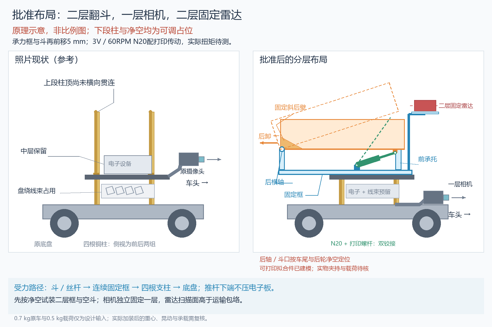

# 已批准的实车分层布局

用户同意将翻斗放到二层、装载区向车身中部移；相机改到一层前端，雷达固定在二层前部独立小座。取消原上段空长柱与第三层平台，保留无活动门的小斗、后横轴、N20驱动打印螺杆，不加金属加强条。

[原生SVG](../images/dump_as_built_plan.svg)为非比例原理图；左图只说明照片原有层级，右图是批准后的新布局，具体运动与数值以 [当前整车CAD](cad/compact_dump_v2/README.md) 为准。用户照片未被修改或提交。

本轮CAD采用可调占位：下柱60 mm、中层板2 mm、连续承力框8 mm（顶Z70）；斗中心X=-15（框与斗再前移5 mm）、后轴Z97。板下100×72×40 mm灰盒预算电子/线束，尚未证明照片盘线能收进去。原中层板画轮廓与孔位参照，没有把旧200×160生产板当实车板。

框的两侧梁/端梁/中横梁连接四个原安装点，承托后轴、前承托及丝杆下耳，推力不压电子板。上段空长柱删除；相机独立架接一层前孔，中心X100/Z40；雷达细座固定二层前部，扫描Z190。真实固定接口和公母牙仍需实配：旧约5 mm露牙不能默认夹住2+8 mm新叠层。

物品顶面相对斗底不得超过70 mm是运输扫描包络假设；散料保持仍受25 mm后沿限制。运输扫描余23 mm，后倾8°起采样遮挡；相机水平视轴与50°竖直FOV假设下，近地盲区约27.6 cm。真实设备/FOV和装载空间要按实物更新。

先按净空试装二层框与空斗、整理线束、确认后口避车尾和相机支架，先打印短牙和D孔试片，再空载手转 [N20驱动试装件](cad/n20_printed_drive_v0/README.md)。用户确认3V、60RPM，工作扭矩未知。700 g原车和0.5 kg目标为历史输入，加装后重量、重心、承载及行驶保持仍需复核；几何占位检查不能当实物稳定保证。

机械接口来源为本地 [VENDOR_INDEX.md](../vendor/VENDOR_INDEX.md)、[车体DXF](../vendor/waveshare_wave_rover/WAVE%20ROVER%20DXF.dxf)、[平台DXF](../vendor/waveshare_wave_rover/WAVE%20ROVER-EP%20DXF.dxf) 和 [厂家STL](../vendor/waveshare_wave_rover/WAVE%20ROVER_MODEL_STL.stl)。双铰接与避免侧载的通用原则参考 [执行器安装说明](https://www.thomsonlinear.com/en/training/precision_linear_actuators/mounting)，该说明只作受力方向参考，当前采用用户N20和打印传动，未套用任何商用执行器尺寸。
